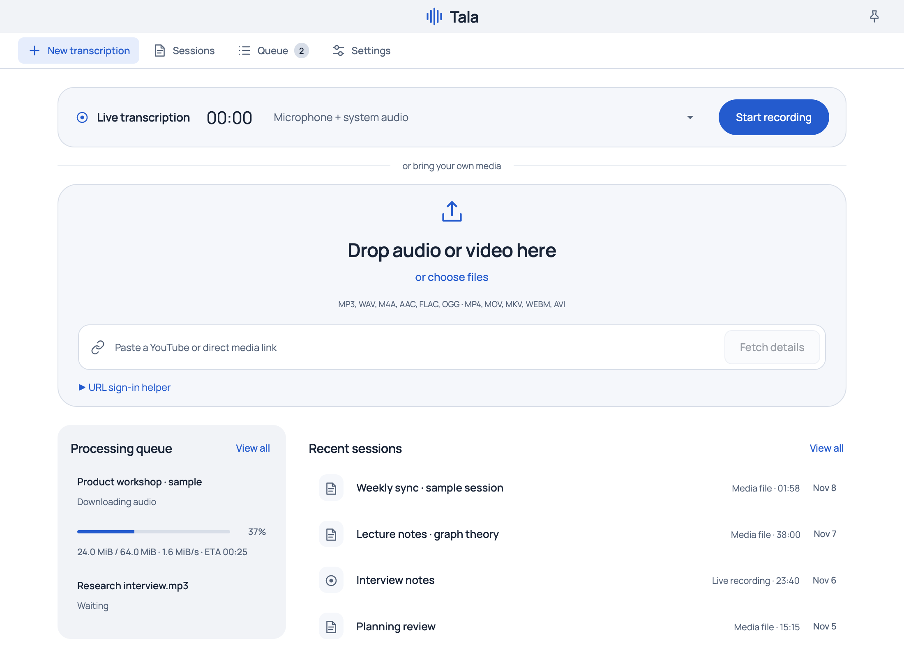
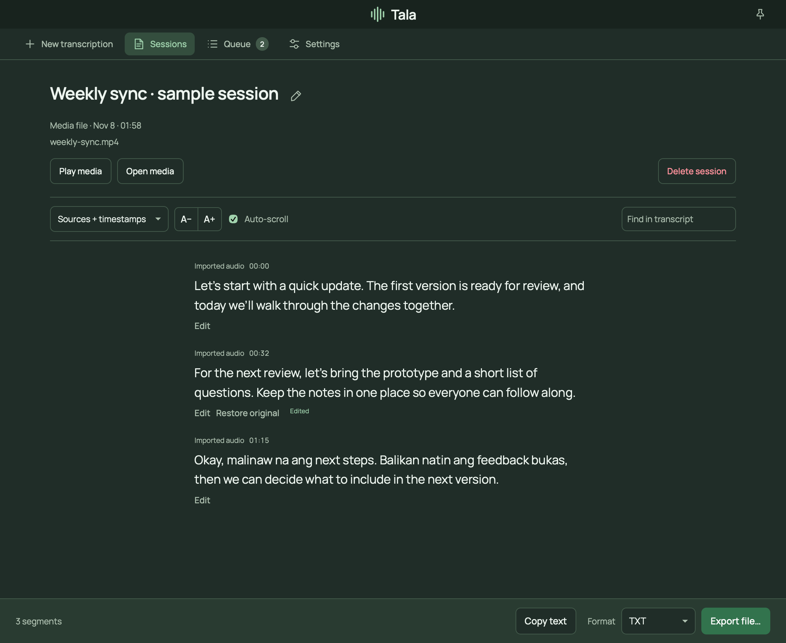
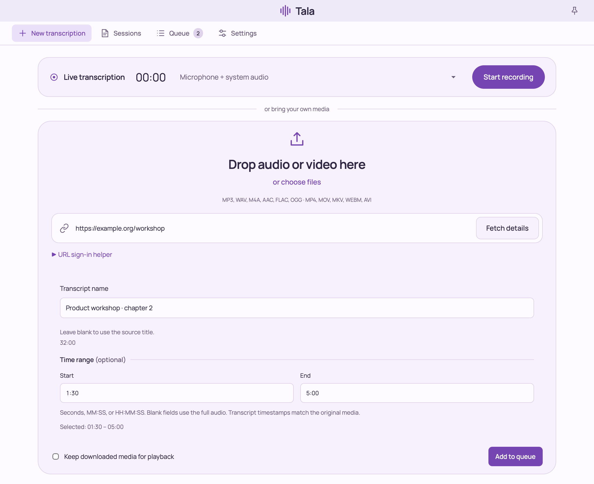

<p align="center">
  
</p>

<h1 align="center">Tala</h1>

<p align="center">
  <strong>Turn audio into text. Keep the transcription on your machine.</strong><br>
  Record, import, review, and export from a macOS dashboard or Linux CLI.
</p>

<p align="center">
  <a href="https://github.com/Ajtn05/Tala/actions/workflows/build.yml"></a>
  <a href="https://github.com/Ajtn05/Tala/releases/latest"></a>
  <a href="LICENSE"></a>
</p>

<p align="center">
  <a href="https://github.com/Ajtn05/Tala/releases/latest/download/Tala.dmg"><strong>Download for macOS</strong></a> ·
  <a href="https://github.com/Ajtn05/Tala/releases/latest/download/tala-linux-x86_64.tar.gz"><strong>Download for Linux</strong></a> ·
  <a href="#get-started">Get started</a> ·
  <a href="docs/GUIDE.md">User guide</a>
</p>



*The v2.2 dashboard, shown with sample sessions. All screenshot text and transfer statistics are illustrative.*

Tala is free, open source, and runs **Whisper Large v3 Turbo locally**. No Tala account, subscription, or cloud inference is required. After the initial model download, live recording and local-file transcription work offline.

## What you can do

| | In Tala |
| --- | --- |
| **Record as you work** | Capture your microphone, system audio, or both on macOS. Record a microphone from the Linux CLI. |
| **Bring files and links** | Drop audio/video files into the dashboard, or import media URLs supported by yt-dlp. Queue multiple files for sequential processing. |
| **Choose just one section** | Set start/end timestamps down to milliseconds, and name a fetched link’s transcript before queueing it. Original media timestamps are preserved. |
| **Follow the work** | See download bytes, speed, and ETA when available, followed by separate transcription progress. Cancel and retry from the queue. |
| **Read, correct, and share** | Search transcripts, save corrections while keeping the original text, and export TXT, Markdown, SRT, or VTT. The CLI also exports JSON. |
| **Keep your language** | Automatic detection supports English, Filipino/Tagalog, Taglish, and other Whisper languages. Tala transcribes the original speech without translating or rewriting it. |
| **Make it comfortable** | Choose six color schemes, light/dark appearance, adjustable text size, and paragraph, single-line, timestamp, or source views. |

| Review and export | Name and trim an import |
| --- | --- |
|  |  |

*Open either image to see the full-size interface.*

## Downloads

| Platform | Download | Requirements |
| --- | --- | --- |
| **macOS app** | [Tala.dmg](https://github.com/Ajtn05/Tala/releases/latest/download/Tala.dmg) | Apple Silicon (M1 or later), macOS 14.2+; Metal acceleration |
| **Linux CLI** | [tala-linux-x86_64.tar.gz](https://github.com/Ajtn05/Tala/releases/latest/download/tala-linux-x86_64.tar.gz) | x86_64; built on Ubuntu 24.04; CPU inference |

[Release notes](https://github.com/Ajtn05/Tala/releases/latest) · [SHA-256 checksums](https://github.com/Ajtn05/Tala/releases/latest/download/SHA256SUMS.txt) · [Build from source](docs/DEVELOPMENT.md)

**First-time setup:** packages do not include the approximately **1.6 GB transcription model**. Allow at least **2 GB of free space** for the app and model, plus space for imported media. Tala verifies the model before using it and reuses compatible existing models in place.

## Get started

### macOS

1. **Install Tala.** Open the DMG, copy **Tala.app** into `~/Applications/`, and open it. If macOS blocks the ad-hoc signed app, use **System Settings → Privacy & Security → Open Anyway**.
2. **Set up the model.** Open **Settings** and wait for discovery. If no compatible model is found, choose **Download model (1.6 GB)** and wait for verification to finish. You do not need the original Kian app or any development tools.
3. **Make a transcript.** On **New transcription**, choose a source and **Start recording**, drop a file, or paste a media link. File/link imports have a review step before **Add to queue**. Open the saved session to edit, copy, or export it.

**Importing files or links?** Install the optional media tools with [Homebrew](https://brew.sh/), then choose **Settings → Media tools → Check again**:

```sh
brew install ffmpeg         # Local audio/video files; includes ffprobe
brew install ffmpeg yt-dlp  # Files and media URLs
```

Live recording needs no extra media tools. Grant microphone/audio capture and Documents access when macOS asks. Saved transcripts live in `~/Documents/Kian/`; this folder name is retained for compatibility.

### Linux

Download the archive above, then extract it and install FFmpeg for file imports. On Ubuntu/Debian:

```sh
tar -xzf tala-linux-x86_64.tar.gz
sudo apt update
sudo apt install ffmpeg

# Download once, verify, then transcribe a file.
./tala --ensure-model
./tala --check-model
./tala --transcribe lecture.mp4
```

The prebuilt CLI needs compatible ALSA, C++ and OpenMP runtimes. URL imports also require a current **yt-dlp**. Linux provides a headless CLI with microphone capture; the desktop dashboard and system-audio capture are macOS-only. See the [Linux setup guide](docs/GUIDE.md#linux-and-command-line-usage) for model paths and build options.

## Everyday workflows

### Record → review → export

Choose **Microphone only**, **System audio only**, or **Microphone + system audio**, then start recording. Stop to finish the transcript. In the viewer, search with **⌘F**, hover or focus a segment to **Edit**, and use **Copy text** or **Export file…** in the bottom toolbar. Corrections can be restored to their original text.

### Import only the part you need

Drop a file, or paste a link and choose **Fetch details**. For a link, edit **Transcript name** before queueing. Set **Start** and **End** using seconds (`90`), `MM:SS` (`1:30`), or `HH:MM:SS` (`1:02:30`); milliseconds such as `1:30.250` also work. Blank fields use the beginning/end of the source.

Only the selected audio is transcribed. Subtitle timestamps retain the source timeline. URL imports download the complete source before processing the selection.

### Use a link that needs sign-in

Expand **URL sign-in helper**, select your browser/profile, and **Open site to sign in**. Save the selection and fetch details again. **Zen** supports profile discovery; **Dia** and unlisted browsers use a Netscape `cookies.txt` export. **Copy URL** lets you open the link in any browser.

See the [sign-in guide](docs/GUIDE.md#url-sign-in-helper) for browser profiles and cookie files. Access depends on the website and yt-dlp support; DRM-protected media is unsupported.

### Work from the terminal

The commands below use the Linux executable. On macOS, use `"$HOME/Applications/Tala.app/Contents/MacOS/tala"` in place of `./tala`. Put options before input paths and quote URLs:

```sh
# Plain text, subtitles, or one selected interval.
./tala --transcribe lecture.mp4
./tala --format srt --transcribe lecture.mp4 > lecture.srt
./tala --start 1:30 --end 5:00 --transcribe lecture.mp4

# A signed-in link, or a timed microphone recording.
./tala --cookies-from-browser zen --transcribe 'https://example.org/media'
./tala --record --duration 1m

# Find saved sessions and export one without loading the model.
./tala --list
./tala --export SESSION_ID --format md > notes.md
```

Progress goes to **stderr**; transcript output goes to **stdout**. Use `--progress=auto|always|never` to control the display. See the [full CLI reference](docs/GUIDE.md#command-line-reference) for formats, vocabulary hints, multiple inputs, and browser-cookie options.

## Questions before you start

<details>
<summary><strong>Does my audio go to a cloud transcription service?</strong></summary>

Recognition runs on your machine. Initial model downloads and media URL imports use the internet. Once the model is set up, microphone recording and local-file transcription can work offline.

</details>

<details>
<summary><strong>Can I use a model I already have?</strong></summary>

Yes. Tala searches for a compatible Whisper Large v3 Turbo model, including existing Kian installations, and verifies its full SHA-256 checksum. Choose a path in **Settings** or use `--model /path/to/ggml-large-v3-turbo.bin`. The verified model is used in place. Other models and quantized variants are not supported. See [model discovery](docs/GUIDE.md#reuse-your-existing-model).

</details>

<details>
<summary><strong>What survives an update?</strong></summary>

Models, settings, transcripts, corrections, and queued imports are stored outside the app bundle. A new download does not include or replace these files. The inherited `Kian` folder names on macOS are intentional. See [storage and updates](docs/GUIDE.md#install-and-update-safely).

</details>

<details>
<summary><strong>How fast and accurate is it?</strong></summary>

Tala uses Whisper Large v3 Turbo, with Metal acceleration on macOS and CPU inference on Linux. Speed depends on hardware, recording length, and audio content. Language quality also depends on the recording; vocabulary hints can help with names and specialist words but do not guarantee spelling. See the [measured import experiments](docs/IMPORT_PERFORMANCE.md) and [verification notes](docs/VERIFICATION.md).

</details>

## Guides and development

- [User guide](docs/GUIDE.md) — full setup, recording, imports, sign-in, transcript editing, CLI options, and model/storage details.
- [Build and contribute](docs/DEVELOPMENT.md) — macOS/Linux builds, packaging, architecture, and verification commands.
- [What changed in 2.2.0](docs/releases/v2.2.0.md) — the latest UI and import improvements.
- [Report an issue](https://github.com/Ajtn05/Tala/issues) — include your platform and the steps to reproduce it.

Tala builds on [Kian](https://github.com/viktorminko/kian) and [whisper.cpp](https://github.com/ggml-org/whisper.cpp). Application code is [MIT licensed](LICENSE). The bundled Manrope font uses the [SIL Open Font License](internal/dashboard/assets/Manrope-OFL.txt).
